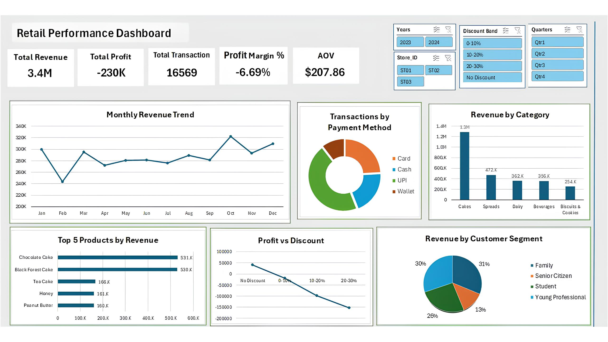

# Retail Performance Analysis Dashboard | Excel 📊

## 📌 Project Overview
This project focuses on analyzing the sales and profitability performance of a fictional bakery business using Microsoft Excel. 

The goal was to transform raw transactional data into an interactive dashboard that helps identify business trends, evaluate product performance, and understand the relationship between discounts and profitability. The project was completed entirely in Microsoft Excel, using Pivot Tables, Pivot Charts, slicers, and calculated metrics.

Dashboard Preview

---

## 📂 Dataset
- **Size:** 16,569 transactions
- **Includes:** Sales, products, customers, discounts, profitability, and operational information.

### Key Data Fields
- Transaction Date and Time
- Product and Category
- Quantity and Selling Price
- Discount Percentage and Amount
- Total Bill and Profit
- Payment Method
- Customer Segment
- Season and Day of Week
- Waste and Inventory Information

---

## 🛠️ Tools & Techniques
- **Microsoft Excel**
- Data Cleaning and Preparation by Power Query
- Pivot Tables & Pivot Charts
- Slicers and Interactive Filtering
- KPI Calculations
- Data Visualization

---

## 📈 Key Performance Indicators (KPIs)
The dashboard tracks the following metrics:
- Total Revenue
- Total Profit
- Average Order Value (AOV)
- Profit Margin
- Total Waste Cost

---

## 🚀 Dashboard Features
- Interactive dashboard with slicers.
- Sales and profitability performance analysis.
- Product and category comparisons.
- Profitability analysis across discount levels.
- Visual representation of key business metrics.

---

## 💡 Key Insights
- The overall business recorded a negative profit margin of approximately **-6.69%**.
- Discount levels showed a noticeable relationship with profitability, with higher discounts generally associated with lower profit margins.
- The **Cakes** category recorded a profit margin of approximately **-8.4%**.
- The analysis highlighted the importance of evaluating discount strategies alongside product-level profitability.

---

## 🎯 Project Objective
This project demonstrates how Excel can be used to analyze business data, identify performance issues, and communicate insights through an interactive dashboard.

---

## ⚙️ How to Use
1. Download the `Retail Projects.xlsx` file.
2. Open it in Microsoft Excel 
3. Use the slicers on the dashboard to filter by Year, Store ID, Discount Band, and Quarter.

---

**Author:** Ibrahim Hagrass  
**Field:** Data Analytics  
**Tools:** Microsoft Excel